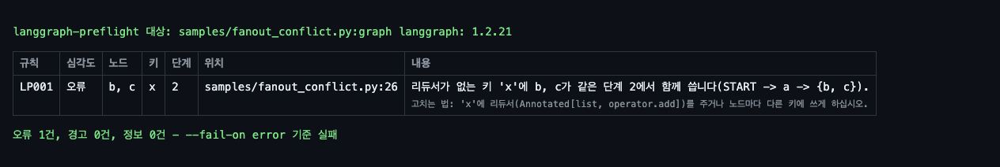
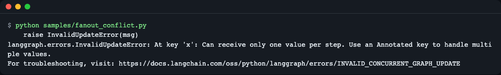
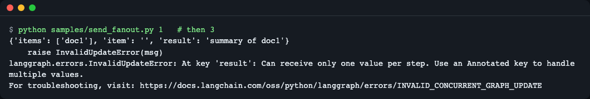
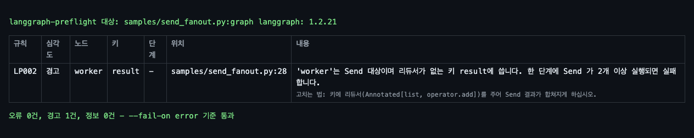
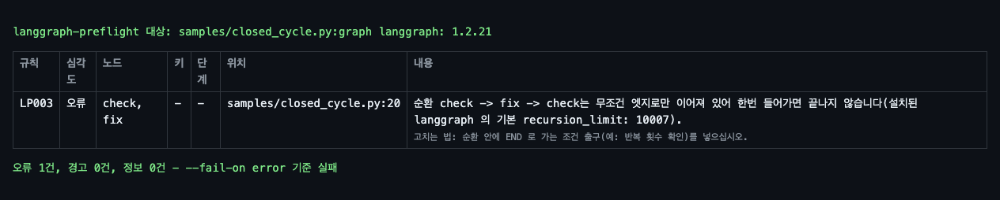
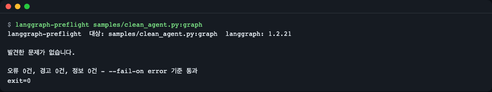
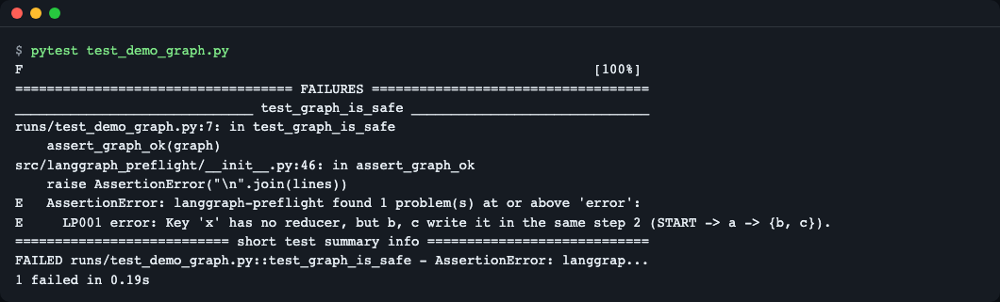
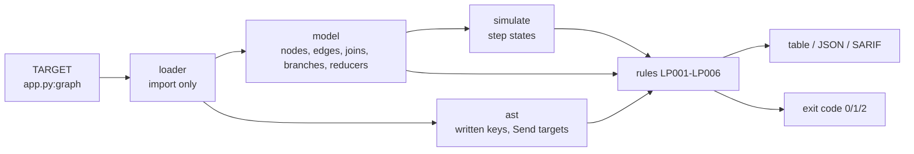

# langgraph-preflight

[English](README.md) | **한국어**

LangGraph 그래프를 **실행하기 전에** 검사합니다. `langgraph-preflight app.py:graph` 한 줄로, 같은 단계에서 리듀서 없는 같은 키에 쓰는 노드, 같은 문제를 가진 `Send` 대상, 영원히 못 빠져나오는 순환을 LLM 을 한 번도 부르지 않고 찾습니다. 그래프 모듈을 import 하지만 노드는 실행하지 않습니다.


*`compile()` 은 통과하는 그래프입니다. 노드 `b` 와 `c` 가 같은 단계에서 실행되며 둘 다 리듀서 없는 `x` 에 씁니다. 종료 코드 1.*

## 왜 필요한가

`StateGraph.compile()` 은 엣지가 실제 노드를 가리키는지만 확인하고 상태가 어떻게 쓰이는지는 보지 않습니다. 아래 세 가지 실수는 `compile()` 을 통과한 뒤 실행 중에, 이미 토큰과 시간을 쓴 다음에야 실패합니다.

| 실수 | 실행할 때 보이는 것 | 규칙 |
|---|---|---|
| 같은 단계의 두 노드가 리듀서 없는 한 키에 씀 | `InvalidUpdateError: At key 'x': Can receive only one value per step` | LP001 |
| `Send` 대상이 리듀서 없는 키에 씀 (한 단계에 Send 가 2개 이상일 때만 실패하므로 입력 1개짜리 테스트는 통과) | 같은 `InvalidUpdateError`, 단 입력이 충분할 때만 | LP002 |
| 무조건 엣지로만 이어진 순환, 출구 없음 | 기본 `recursion_limit`(설치된 langgraph 1.2.21 은 10007) 만큼 돈 뒤 `GraphRecursionError` | LP003 |

배선도를 보고 한 단자에 전선 두 개가 동시에 꽂히는 곳을 찾는 회로 검사기라고 생각하면 됩니다. 기준은 "같은 출발점"이 아니라 "같은 단계"입니다. 짧은 갈래와 긴 갈래도 같은 단계에서 만날 수 있습니다.

API 키·네트워크·GPU 가 필요 없습니다. 예제 노드는 LLM 호출 대신 순수 함수이므로, 이 README 의 모든 출력은 실제 langgraph 1.2.21 에서 실제 도구를 돌려 얻은 것입니다. 연습용 mock 모드도 가짜 출력도 없습니다.

## 설치

도구가 그래프 모듈을 import 하므로 **그래프와 같은 환경**에 설치하세요(`uv tool install` 처럼 격리된 환경에서는 사용자 의존성을 import 할 수 없습니다).

```bash
# uv 가 없다면:  curl -LsSf https://astral.sh/uv/install.sh | sh
uv add --dev git+https://github.com/LeeGyeongPil/langgraph-preflight   # 내 프로젝트에서
# pip 로:        pip install git+https://github.com/LeeGyeongPil/langgraph-preflight
# 한 번만 실행:  uv run --with git+https://github.com/LeeGyeongPil/langgraph-preflight langgraph-preflight app.py:graph
```

요구 사항: Python 3.10 이상, `langgraph>=1.2.21,<2`(자동 설치). 최소 리눅스 이미지에서는 `git+https` 설치를 위해 `git` 이 필요합니다.

## 빠르게 시작하기

이 저장소를 clone 해서 동봉된 예제로 해 봅니다.

```bash
git clone https://github.com/LeeGyeongPil/langgraph-preflight
cd langgraph-preflight
uv run langgraph-preflight samples/fanout_conflict.py:graph; echo "exit=$?"
```

```text
langgraph-preflight  target: samples/fanout_conflict.py:graph  langgraph: 1.2.21

RULE   SEVERITY  NODES  KEYS  STEP  WHERE
-----  --------  -----  ----  ----  -----------------------------
LP001  error     b, c   x     2     samples/fanout_conflict.py:26

LP001  Key 'x' has no reducer, but b, c write it in the same step 2 (START -> a -> {b, c}).
       fix: Give 'x' a reducer (Annotated[list, operator.add]) or let each node write its own key.

1 error(s), 0 warning(s), 0 info - fails --fail-on error
exit=1
```

(위는 영어 화면입니다. 한국어 화면은 아래 [언어](#언어)를 보세요.)

읽는 법: `NODES`/`KEYS` 는 누가 무엇에 쓰는지, `STEP` 은 일이 벌어지는 슈퍼스텝, 괄호 안은 거기까지 `START` 에서 가는 경로, `WHERE` 는 노드 함수 위치입니다. 종료 코드 1 은 `--fail-on`(기본 `error`) 이상의 발견이 있다는 뜻입니다.

내 그래프에는 `file.py:name` 또는 `package.module:name` 을 주면 됩니다. `name` 은 컴파일된 그래프, `StateGraph`, 또는 그것을 돌려주는 인자 없는 함수입니다(LLM 클라이언트는 그 함수 안에서 만들면 import 에 키가 필요 없습니다).

```bash
uv run langgraph-preflight agent/graph.py:graph
uv run langgraph-preflight myapp.agent:build_graph
```

### 실제 실행과 대조

모든 예제는 직접 실행할 수 있어 예측이 현실과 맞는지 볼 수 있습니다(`uv run python samples/fanout_conflict.py`).


*위 예측을 그래프를 돌려 확인한 모습. 이 화면은 langgraph 가 내는 원문이라 영어입니다.*

Send 문제는 입력 크기 뒤에 숨습니다(`send_fanout.py 1` 은 통과, `3` 은 실패).


*LP002 가 있는 이유: 입력 하나짜리 테스트로는 잡히지 않습니다. 이 화면은 langgraph 의 원문 출력이라 영어입니다.*


*정적 검사는 어느 입력도 돌리지 않고 경고합니다.*

닫힌 순환(`closed_cycle.py`)은 설치된 기본 `recursion_limit` 과 함께 보고됩니다.


*LP003: `check -> fix -> check` 는 무조건 엣지로만 이어져 있습니다.*

깨끗한 그래프는 종료 코드 0 으로 통과합니다.


*발견 없음, 종료 코드 0.*

## 규칙

| 규칙 | 심각도 | 뜻 | 고치는 법 |
|---|---|---|---|
| LP001 concurrent-write | error | 같은 단계에 실행될 수 있는 노드들이 리듀서 없는 한 키에 씁니다. 단계 번호와 분기 경로를 보여 줍니다. | 리듀서(`Annotated[list, operator.add]`) 추가, 또는 노드마다 다른 키 사용 |
| LP002 send-fanout-write | warning | `Send` 대상이 리듀서 없는 키에 씁니다. 한 단계에 Send 가 2개 이상이면 실패 | 리듀서를 달아 Send 결과를 합치기 |
| LP003 closed-cycle | error | 앞으로 가는 길이 모두 순환 안에 머무는 순환(무조건 엣지, 또는 가능한 목적지가 모두 순환 안). 설치된 기본 `recursion_limit` 을 표시(못 읽으면 `unknown`) | 순환 안에 `END` 로 가는 조건 출구(예: 반복 횟수 확인) 추가 |
| LP004 unreachable-node | warning (`Send`/`Command` 대상이거나 도착지가 선언되지 않은 라우트로만 닿는 노드면 info) | `START` 에서 갈 수 없는 노드 | 엣지를 잇거나 노드 삭제 |
| LP005 opaque-route | warning | `path_map` 도 `Literal` 반환 힌트도 없는 조건 분기, 또는 `Command[Literal[...]]` 힌트 없이 `Command` 를 돌려주는 노드. 등록 안 된 이름을 돌려주면 조용히 끝납니다. | `path_map` 을 주거나 `Literal` 힌트 추가 |
| LP006 analysis-gap | info | 분석하지 못한 부분: 쓰는 키를 모름, `--max-states` 로 탐색이 잘림, 목적지 리스트를 돌려주는 라우터 | 참고용. 모르는 부분은 LP001 에서 빠집니다 |

조건 출구가 있는 순환은 보고하지 않습니다.

## 사용법

```text
langgraph-preflight TARGET [--format table|json|sarif] [--output PATH]
                    [--fail-on error|warning|never] [--lang en|ko]
                    [--max-states N] [--debug] [--version]
```

| 옵션 | 하는 일 |
|---|---|
| `TARGET` | `file.py:name` 또는 `package.module:name` (모듈 최상위 이름 하나) |
| `--format` | `table`(기본), `json`, `sarif`(2.1.0) |
| `--output PATH` | JSON/SARIF 보고서를 파일로 씁니다. 새 경로는 만들고, 기존 파일은 이전 langgraph-preflight 보고서일 때만 교체합니다. 그 밖의 파일이면 종료 코드 2 이고 파일은 그대로입니다. `table` 과는 함께 쓸 수 없습니다. |
| `--fail-on` | 종료 코드 1 이 되는 최저 심각도(기본 `error`) |
| `--max-states N` | 탐색하는 단계 상태 상한(기본 20000). 넘으면 LP006 안내 |
| `--debug` | 로드 실패 시 전체 트레이스백 |
| `--lang` | 화면 언어, [언어](#언어) 참고 |

종료 코드: `0` 통과, `1` `--fail-on` 이상 발견, `2` 사용 오류·로드 실패·출력 거부. 사용자 소스는 읽기만 하고 수정하지 않습니다.

JSON(`--format json`)에는 `tool`·`tool_version`·`langgraph_version`·`schema_version`·`target`·`summary`, 그리고 `rule`·`name`·`severity`·`message`·`message_id`·`args`·`nodes`·`keys`·`step`·`path`·`location` 을 가진 `findings[]` 가 있습니다. 메시지는 항상 영어이므로 화면 언어와 상관없이 같은 파일이 나옵니다.

## CI 와 pytest

코드 스캐닝용 SARIF(발견이 노드 함수의 파일·줄을 가리킵니다).

```bash
uv run langgraph-preflight agent/graph.py:graph --format sarif --output preflight.sarif --fail-on error
```

pytest 에서는 이미 import 한 그래프를 넘깁니다.

```python
from langgraph_preflight import assert_graph_ok, check

from samples.fanout_conflict import graph


def test_graph_is_safe():
    assert_graph_ok(graph)          # 규칙·키·노드를 담은 AssertionError

report = check(graph)               # Report: .findings, .max_severity, .to_json(), .to_sarif()
```


*테스트가 규칙·키·노드와 함께 실패합니다. 이 화면은 pytest 의 원문 출력이라 영어입니다.*

## 동작 원리



1. loader 가 모듈을 import 해 이름으로 그래프 객체를 꺼냅니다. 노드는 실행하지 않습니다.
2. model 이 컴파일된 그래프에서 노드, 일반 엣지, join 엣지(모든 출발 노드를 기다림), 조건 분기의 가능한 목적지, 어떤 상태 키에 리듀서가 있는지를 읽습니다.
3. 별도로 각 노드 함수의 소스를 `ast` 로 읽어(`exec` 안 함) 어떤 키에 쓰는지 추정합니다. dict 리터럴, `dict(k=...)`, `Command(update=...)`, `out["k"] = ...`, `out.update(...)` 를 인식합니다. 그 밖(상태 전체 반환, `**` 펼치기, 헬퍼 호출, lambda, 서브그래프)은 "알 수 없음"으로 LP006 에 알리고 LP001 에서는 뺍니다. 그래서 오류(error)는 확실한 키에서만 나옵니다.
4. 너비 우선 탐색이 슈퍼스텝을 따라갑니다. 일반 엣지는 반드시 실행되고, 조건 분기와 `Command` 는 목적지를 하나씩 골라 전개하며, join 은 모든 출발 노드가 끝난 다음 단계에 실행됩니다. 가장 짧은 증거 경로를 남깁니다.
5. 규칙이 그 결과를 읽습니다. 탐색은 "가능성 기반"이라 라우터가 실제로는 고르지 않는 조합을 보고할 수도 있어, 메시지에 어떤 선택이 필요한지 보여 줍니다.

## 언어

화면 문구(표·도움말·로드 오류)는 영어 또는 한국어입니다. 우선순위: `--lang en|ko`, 그다음 `LANGGRAPH_PREFLIGHT_LANG`, 그다음 `LC_ALL` / `LC_MESSAGES` / `LANG`(`ko` 로 시작하면 한국어), 그 밖은 영어. JSON·SARIF·종료 코드는 언어와 상관없이 같습니다.

```bash
uv run langgraph-preflight samples/closed_cycle.py:graph --lang ko
```


*한국어 화면에서는 표 머리글과 설명이 한국어로 나옵니다.*

## 한계

- LangGraph 내부 속성(`builder.edges`, `waiting_edges`, `branches`, `channels`)을 읽습니다. 지원 범위는 `>=1.2.21,<2` 이고, 속성이 없으면 추측하지 않고 종료 코드 2("지원하지 않는 langgraph 버전")로 멈춥니다. CI 에서는 2 미만 최신 langgraph 로도 돌립니다.
- 모델링하지 않는 것: 서브그래프 노드와 prebuilt `ToolNode`(쓰기 키를 알 수 없음으로 처리), `defer=True`, `RetryPolicy`, interrupt, 함수형 API(`@entrypoint`), LangGraph.js.
- 라우터는 한 단계에 목적지 하나를 고른다고 가정합니다. 리스트를 돌려주는 라우터는 LP006 으로 알리고 전개하지 않습니다.
- 쓰는 키는 위에 적은 `ast` 패턴에서만 얻고, 나머지는 추측하지 않고 알 수 없음으로 둡니다.
- 코드를 고쳐 주지 않고 그래프를 실행하지도 않습니다.

## 비교

| | 검사하는 것 | 검사하지 않는 것 |
|---|---|---|
| LangGraph 의 `compile()` | 없는 노드로 가는 엣지, START 엣지, interrupt 노드 | 상태 쓰기 충돌, 순환 |
| [langgraph-lint](https://github.com/mathewOracle/langgraph-lint) 0.1.0 (2026-11-13 확인) | 도달 가능성, `path_map`/`Literal` 일치 | 병렬 쓰기 충돌, Send, 닫힌 순환(해당 README 기준) |
| langgraph-preflight | 단계 단위 쓰기 충돌, Send fan-out, 닫힌 순환, 겹치는 도달 가능성 검사(LP004) | `path_map`/`Literal` 일치: 그것은 langgraph-lint 를 쓰세요 |

서로 보완하는 관계입니다. 다른 도구는 계속 바뀌므로 현재 동작은 각 도구 페이지에서 확인하세요. LangGraph 코드를 리뷰하는 에이전트 스킬은 프롬프트라 결과가 매번 다를 수 있고 종료 코드가 없습니다. 이 도구는 스크립트입니다.

## 로드맵

- 다음: 서브그래프 재귀와 부모 키 쓰기, `defer=True` 단계 이동, 리스트를 돌려주는 라우터, `ToolNode`·`create_react_agent` 의 쓰기 키 내장 표, GitHub Actions 주석, pre-commit 훅 예.
- 그다음: 알려진 발견을 무시하는 기준선 파일(`--baseline`), 함수형 API 검토.

계획은 바뀔 수 있습니다. 필요한 항목이 있으면 이슈로 알려 주세요.

## 자주 겪는 문제

| 증상 | 원인 | 해결 |
|---|---|---|
| 종료 코드 2 와 `file not found` 같은 한 줄 오류 | 경로가 틀렸거나 `name` 이 그래프가 아님 | `file.py:name` 에서 `name` 이 컴파일된 그래프, `StateGraph`, 인자 없는 팩토리인지 확인. `--debug` 로 트레이스백 확인 |
| 내 패키지 import 오류 | 도구가 그래프와 다른 환경에 설치됨 | 그래프의 환경에 설치(설치 절 참고) |
| 키가 없어 import 실패 | 모듈이 import 시점에 LLM 클라이언트를 만듦 | 클라이언트를 팩토리 함수 안에서 만들고 그 함수를 대상으로 지정 |
| 종료 코드 2 "지원하지 않는 langgraph 버전" | langgraph 업데이트로 내부 구조가 바뀜 | `langgraph>=1.2.21,<2` 로 고정하거나 이슈 등록 |
| LP006 "상태 N개에서 탐색을 멈췄습니다" | 단계 상태가 `--max-states` 보다 많음 | `--max-states` 를 키우기 |
| 종료 2 "이 그래프는 만들 수 없습니다(compile() 이 실패합니다)" | StateGraph 자체가 잘못됨(예: START 에서 나가는 엣지 없음) | `compile()` 이 되도록 그래프를 고친 뒤 다시 실행 |

## 개발

```bash
uv run pytest -q
```

테스트 61개, 네트워크 불필요. 버그·제안은 이슈로 남겨 주세요. 변경 기록은 [CHANGELOG.md](CHANGELOG.md).

## 라이선스

MIT, [LICENSE](LICENSE) 참고.
