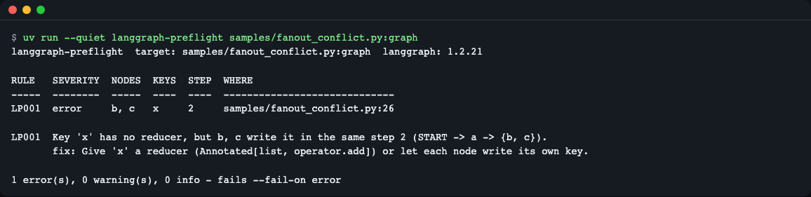
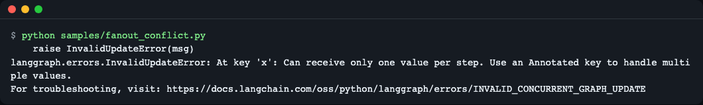
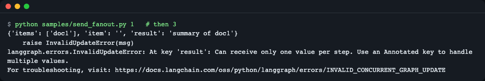
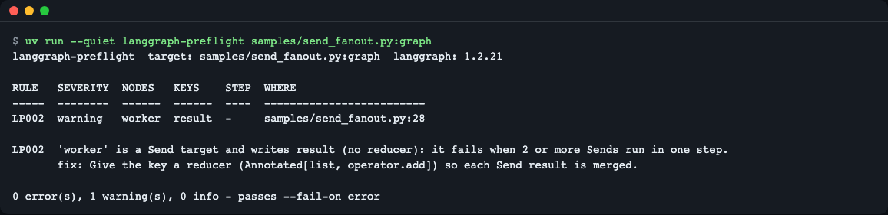
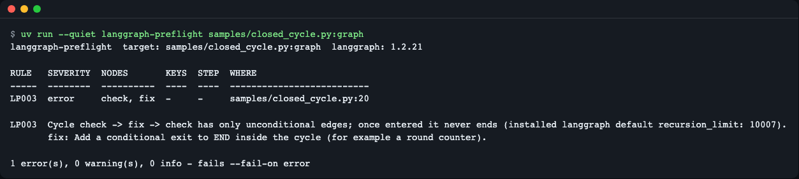
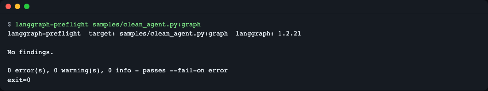
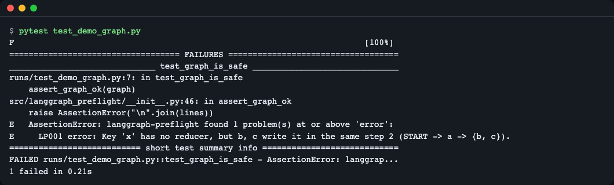
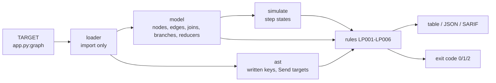

# langgraph-preflight

**English** | [한국어](README.ko.md)

Check a LangGraph graph **before it runs**. `langgraph-preflight app.py:graph` finds nodes that write the same reducer-less key in one step, `Send` targets that do the same, and cycles that can never exit, without calling an LLM once. It imports your graph module but never executes a node.


*A graph that compiles fine: nodes `b` and `c` run in the same step and both write `x`, which has no reducer. Exit code 1.*

## Why

`StateGraph.compile()` checks that edges point at real nodes. It does not check how your state is written. Three mistakes pass `compile()` and only fail during a run, after you have already spent tokens and time:

| Mistake | What you see at run time | Rule |
|---|---|---|
| Two nodes in the same step write one key that has no reducer | `InvalidUpdateError: At key 'x': Can receive only one value per step` | LP001 |
| A `Send` target writes a reducer-less key (fails only when 2 or more Sends run in one step, so a one-item test input passes) | the same `InvalidUpdateError`, but only with enough input | LP002 |
| A cycle of unconditional edges with no way out | `GraphRecursionError` after the default `recursion_limit` (10007 in the installed langgraph 1.2.21) | LP003 |

Think of it as a circuit checker that reads the wiring diagram and finds the terminal where two wires are plugged in at once. "Same step" is what matters, not "same starting node": a short branch and a long branch can meet in the same step.

No API key, no network, no GPU. The sample nodes are plain functions standing in for LLM calls, so every output in this README was produced by running the real tool on real langgraph 1.2.21. There is no mock mode and no fake output.

## Install

The tool imports your graph module, so install it **in the same environment as your graph** (an isolated `uv tool install` could not import your dependencies).

```bash
# install uv if you do not have it:  curl -LsSf https://astral.sh/uv/install.sh | sh
uv add --dev git+https://github.com/LeeGyeongPil/langgraph-preflight   # in your project
# or with pip:   pip install git+https://github.com/LeeGyeongPil/langgraph-preflight
# one-off run:   uv run --with git+https://github.com/LeeGyeongPil/langgraph-preflight langgraph-preflight app.py:graph
```

Requirements: Python 3.10+ and `langgraph>=1.2.21,<2` (installed automatically). On a minimal Linux image you need `git` for the `git+https` install.

## Quick start

Try the bundled samples from a clone of this repository:

```bash
git clone https://github.com/LeeGyeongPil/langgraph-preflight
cd langgraph-preflight
uv run langgraph-preflight samples/fanout_conflict.py:graph; echo "exit=$?"
```

```text
langgraph-preflight  target: samples/fanout_conflict.py:graph  langgraph: 1.2.21

RULE   SEVERITY  NODES  KEYS  STEP  WHERE
-----  --------  -----  ----  ----  -----------------------------
LP001  error     b, c   x     2     samples/fanout_conflict.py:26

LP001  Key 'x' has no reducer, but b, c write it in the same step 2 (START -> a -> {b, c}).
       fix: Give 'x' a reducer (Annotated[list, operator.add]) or let each node write its own key.

1 error(s), 0 warning(s), 0 info - fails --fail-on error
exit=1
```

How to read it: `NODES`/`KEYS` say who writes what, `STEP` is the superstep where it happens, the path in parentheses is the route from `START` that gets there, and `WHERE` points at the node function. Exit code 1 means a finding at or above `--fail-on` (default `error`).

For your own graph, give `file.py:name` or `package.module:name`. `name` can be a compiled graph, a `StateGraph`, or a function with no arguments that returns one (create LLM clients inside that function so importing the module needs no key):

```bash
uv run langgraph-preflight agent/graph.py:graph
uv run langgraph-preflight myapp.agent:build_graph
```

### Compare with the real run

Every sample can run directly, so you can see the prediction match reality (`uv run python samples/fanout_conflict.py`):


*The prediction above, confirmed by running the graph.*

The Send case hides behind the input size (`send_fanout.py 1` passes, `3` fails):


*Why LP002 exists: a test with one input would not catch it.*


*The static check warns without running either input.*

A closed cycle (`closed_cycle.py`) is reported with the installed default `recursion_limit`:


*LP003: `check -> fix -> check` has only unconditional edges.*

A `Command(goto=["p", "q"])` list (`command_fanout_conflict.py`) runs both nodes in one step, so it is reported as LP001 too.

A clean graph passes with exit code 0:


*No findings, exit 0.*

## Rules

| Rule | Severity | Meaning | Typical fix |
|---|---|---|---|
| LP001 concurrent-write | error | Nodes that can run in the same step write one key that has no reducer. Shows step number and branch path. | Add a reducer (`Annotated[list, operator.add]`) or give each node its own key |
| LP002 send-fanout-write | warning | A `Send` target writes a reducer-less key; fails with 2+ Sends in one step | Add a reducer so each Send result is merged |
| LP003 closed-cycle | error | A cycle where every way forward stays inside the cycle (unconditional edges, or all destinations in the cycle). Shows the installed default `recursion_limit` (or `unknown` if unreadable). | Add a conditional exit to `END` (for example a round counter) |
| LP004 unreachable-node | warning (info for `Send`/`Command` targets or nodes reachable only through a route with undeclared destinations) | A node cannot be reached from `START` | Add an edge or remove the node |
| LP005 opaque-route | warning | A conditional edge without `path_map` or a `Literal` return hint, or a node returning `Command` without a `Command[Literal[...]]` hint. An unknown name silently ends the run. | Pass a `path_map` or add the `Literal` hint |
| LP006 analysis-gap | info | Something could not be analysed: written keys unknown, exploration truncated by `--max-states`, router returning a list of destinations, `Command(goto=[...])` with non-literal items | Informational; the unknown part is left out of LP001 |

A cycle with a conditional way out is not reported.

## Usage

```text
langgraph-preflight TARGET [--format table|json|sarif] [--output PATH]
                    [--fail-on error|warning|never] [--lang en|ko]
                    [--max-states N] [--debug] [--version]
```

| Option | What it does |
|---|---|
| `TARGET` | `file.py:name` or `package.module:name` (a single top-level name) |
| `--format` | `table` (default), `json`, or `sarif` (2.1.0) |
| `--output PATH` | Write the JSON/SARIF report to a file. A new path is created; an existing file is replaced only if it is an earlier langgraph-preflight report, otherwise exit 2 and the file is untouched. Not allowed with `table`. |
| `--fail-on` | Lowest severity that makes exit code 1 (default `error`) |
| `--max-states N` | Cap on explored step states (default 20000); beyond it you get an LP006 note |
| `--debug` | Full traceback when loading fails |
| `--lang` | Screen language, see [Language](#language) |

Exit codes: `0` pass, `1` findings at or above `--fail-on`, `2` usage error, load failure, or refused output. Your sources are only read, never modified.

JSON (`--format json`) has `tool`, `tool_version`, `langgraph_version`, `schema_version`, `target`, `summary` and `findings[]` with `rule`, `name`, `severity`, `message`, `message_id`, `args`, `nodes`, `keys`, `step`, `path`, `location`. Messages are always English, so the file is the same whatever the screen language.

## CI and pytest

SARIF for code scanning (the finding points at the node function's file and line):

```bash
uv run langgraph-preflight agent/graph.py:graph --format sarif --output preflight.sarif --fail-on error
```

In pytest, pass an already imported graph:

```python
from langgraph_preflight import assert_graph_ok, check

from samples.fanout_conflict import graph


def test_graph_is_safe():
    assert_graph_ok(graph)          # AssertionError listing rule, key and nodes

report = check(graph)               # Report: .findings, .max_severity, .to_json(), .to_sarif()
```


*The test fails with the rule, the key and the nodes.*

## How it works



1. The loader imports your module and takes the graph object by name. No node is executed.
2. The model reads the compiled graph: nodes, plain edges, join edges (wait for all sources), possible destinations of conditional edges, and which state keys have a reducer.
3. A separate pass reads each node function's source with `ast` (never `exec`) to estimate which keys it writes: dict literals, `dict(k=...)`, `Command(update=...)`, `out["k"] = ...`, `out.update(...)`. Anything else (returning the whole state, `**` spreading, helper calls, lambdas, subgraphs) is marked unknown, reported as LP006, and left out of LP001 so errors come only from keys it is sure about.
4. A breadth-first search walks supersteps: plain edges always fire, a conditional edge or a single-destination `Command` is expanded one destination at a time (a `Command` goto list literal runs all listed nodes in the same step), and a join fires the step after all its sources finished. The shortest evidence path is kept.
5. The rules read the result. The search is possibility-based: it may report a branch combination your router never picks, so the message shows which picks are required.

## Language

Screen text (table, help, load errors) is English or Korean. Order of precedence: `--lang en|ko`, then `LANGGRAPH_PREFLIGHT_LANG`, then `LC_ALL` / `LC_MESSAGES` / `LANG` (a value starting with `ko` means Korean), otherwise English. JSON, SARIF and exit codes never change with the language.

```bash
uv run langgraph-preflight samples/closed_cycle.py:graph --lang ko
```

## Limits

- It reads LangGraph internals (`builder.edges`, `waiting_edges`, `branches`, `channels`). Supported range is `>=1.2.21,<2`; if an attribute is missing it stops with exit 2 ("unsupported langgraph version") rather than guessing. CI also runs against the newest langgraph below 2.
- Not modelled: subgraph nodes and prebuilt `ToolNode` (treated as unknown writes), `defer=True`, `RetryPolicy`, interrupts, the functional API (`@entrypoint`), LangGraph.js.
- Routers are assumed to pick one destination per step; a router returning a list is flagged LP006 and not expanded.
- `Command(goto=[...])` with a list literal of node names is expanded as all of them running in the same step (so LP001 can fire); a list that is not all string literals is flagged LP006.
- Written keys come from the `ast` patterns listed above; the rest is unknown, never guessed.
- It does not fix your code and does not run the graph.

## Compared with

| | Checks | Does not check |
|---|---|---|
| `compile()` in LangGraph | edges to missing nodes, START edges, interrupt nodes | state write conflicts, cycles |
| [langgraph-lint](https://github.com/mathewOracle/langgraph-lint) 0.1.0 (checked 2026-11-13) | reachability, `path_map`/`Literal` agreement | parallel write conflicts, Send, closed cycles (per its README) |
| langgraph-preflight | step-level write conflicts, Send fan-out, closed cycles, plus an overlapping reachability check (LP004) | `path_map`/`Literal` agreement: use langgraph-lint for that |

They complement each other. Other tools change over time; check their own pages for current behaviour. Agent skills that review LangGraph code are prompts, so their result is not deterministic and gives no exit code; this tool is a script.

## Roadmap

- Next: subgraph recursion and parent-key writes, `defer=True` step shifts, routers that return lists, built-in write tables for `ToolNode` and `create_react_agent`, GitHub Actions annotations, a pre-commit hook example.
- Later: a baseline file (`--baseline`) to ignore known findings, a look at the functional API.

Plans can change; open an issue if one of these matters to you.

## Troubleshooting

| Symptom | Cause | Fix |
|---|---|---|
| Exit 2 and a one-line error such as `file not found` | Wrong path or `name` is not a graph | Use `file.py:name` where `name` is a compiled graph, `StateGraph`, or a no-argument factory; add `--debug` for the traceback |
| Import error for your own packages | Tool installed in a different environment than the graph | Install it into the graph's environment (see Install) |
| Import fails because a key is missing | Module builds an LLM client at import time | Build the client inside a factory function and target that |
| Exit 2 "unsupported langgraph version" | Internals changed in a langgraph release | Pin `langgraph>=1.2.21,<2` or open an issue |
| LP006 "Exploration stopped after N states" | More step states than `--max-states` | Raise `--max-states` |
| Exit 2 "this graph cannot be built (compile() would fail)" | The StateGraph itself is invalid (for example no edge from START) | Fix the graph so `compile()` succeeds, then rerun |

## Development

```bash
uv run pytest -q
```

Tests run without network. Bugs and ideas: open an issue. Changes: [CHANGELOG.md](CHANGELOG.md).

## License

MIT, see [LICENSE](LICENSE).
